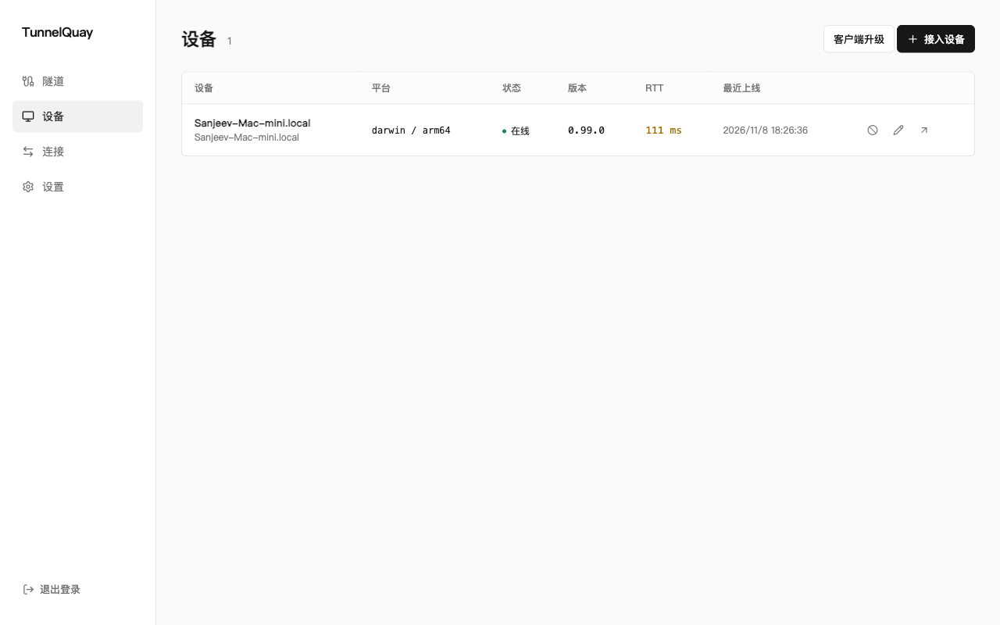
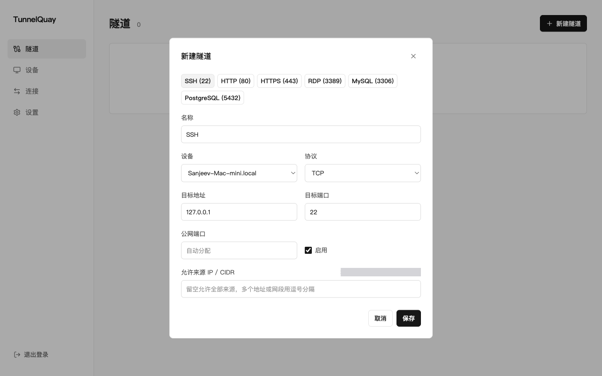
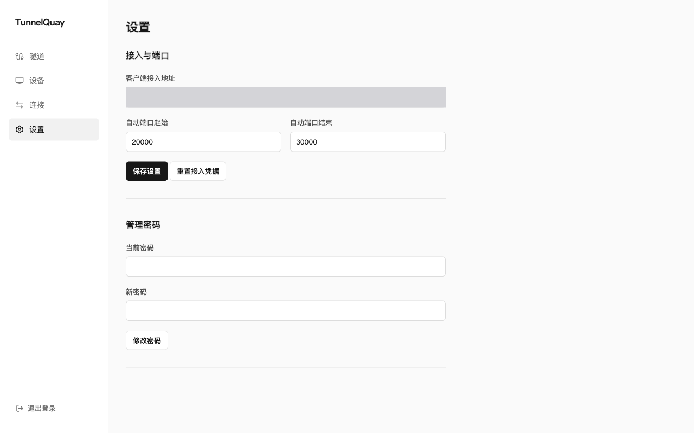

# TunnelQuay

TunnelQuay 是面向个人自托管的 TCP、UDP 内网穿透工具。通过服务端 Web 面板统一管理多台设备和端口映射，客户端使用服务端地址、端口和接入凭据连接。

已实现独立服务端、客户端与中文管理界面。平台验证范围、已确认缺陷和公网稳定性缺口见 [验收记录](docs/verification.md)。

## 界面预览

截图中的公网 IP 与接入地址已遮盖。

设备列表



新建隧道（SSH 预设，尚未保存）



接入与端口设置



## 从源码开始

工具链与环境要求见 [开发准备](docs/development.md#开发)。先构建前端，再构建两个程序。

```sh
pnpm --dir web install --frozen-lockfile
pnpm --dir web build
go build -o bin/ ./cmd/tunnelquay-server ./cmd/tunnelquay-client
```

Linux、macOS 启动服务端：

```sh
./bin/tunnelquay-server -listen :7000 -data-dir data/server
```

Windows 使用 `.\bin\tunnelquay-server.exe`，参数相同。首次启动会显示临时管理密码与客户端接入凭据。浏览器打开 `http://服务器地址:7000`，登录后修改临时密码。

在设备页点击“接入设备”即可复制接入命令（支持直接自动推导当前服务端地址），或手动运行：

```sh
./bin/tunnelquay-client -connect 'tq://替换为接入凭据@203.0.113.10:7000'
```

Windows 使用 `.\bin\tunnelquay-client.exe`。客户端还支持环境变量 `TUNNELQUAY_CONNECT` 或拆分参数 `-address`、`-port`、`-credential`，完整参数与默认值见 [客户端入口](cmd/tunnelquay-client/main.go) 与 [服务端入口](cmd/tunnelquay-server/main.go)。设备上线后即可在面板创建隧道，正式构建与常驻部署见 [开发与部署](docs/development.md)。

## 使用方式

服务端与客户端均以前台方式运行，常驻由外部守护管理。所有隧道配置保存在服务端，客户端保持无状态并按服务端拨号原语转发流量，修改映射无需登录客户端设备。

| 能力 | 已实现行为 |
| --- | --- |
| 隧道协议 | TCP、UDP、TCP + UDP，支持隧道克隆与常用服务快捷预设 |
| 目标地址 | 客户端可访问的本机或局域网 IP、域名与端口，支持设备上线、保存时自动探测与手动探测连通性 |
| 公网端口 | 手动指定，或从设置范围内自动分配，分配后保持固定；支持一键复制公网访问地址 |
| 来源访问控制 | 按隧道配置允许访问的来源 IP / CIDR 白名单，支持自动识别反向代理后的管理员当前 IP 并一键填入 |
| 客户端接入 | TLS 1.3 + Yamux 多路复用 TCP 接入，支持 `-connect` 单连接串、环境变量、服务端一键安装脚本及 `-service install/uninstall` 常驻服务管理 |
| 设备观测 | 在线状态、版本、往返延迟、隧道和错误 |
| 设备身份 | 独立 Ed25519 密钥认证、身份撤销、离线设备清理、共享登记凭据重置与服务端 `-reset-password` 管理密码重置 |
| 连接记录 | 来源地址、起止时间、流量、结果，保留与清理规则见 [历史与观测](docs/design.md#历史与观测) |
| 客户端升级 | Web 发起，支持自动拉取官方签名发行包，验证签名和替换程序后退出，重新上线确认实际版本；需要配置正式发行公钥 |

服务端以单个 TCP 端口同时提供管理 HTTP 与客户端 TLS 接入，业务映射监听额外公网端口。Web 域名与 HTTPS 由用户反向代理处理；客户端直连服务端并独立校验服务端证书公钥指纹。

## 技术与目录

后端采用 Go 与 SQLite（`modernc.org/sqlite`），客户端和服务端分别构建。管理端采用 React、TypeScript、Vite、React Router、shadcn/ui、Tailwind CSS，构建产物嵌入服务端二进制。

```text
cmd/
  tunnelquay-server/    服务端入口
  tunnelquay-client/    客户端入口
internal/
  server/              设备管理、隧道调度、管理 API
  client/              接入、无状态拨号转发、自更新
  protocol/            消息、版本、能力协商与 UDP 封包
  transport/           TLS + Yamux 复用会话与证书固定
  store/               SQLite 存储与历史清理
  update/              发行清单签名校验与归档解包
  webui/               管理端资源嵌入
  buildinfo/           程序版本与构建信息
web/                   React 管理端
docs/                  设计、开发与版本日志
scripts/               版本及必要构建工具
.github/workflows/     持续集成与发布
```

## 开发与发布

需求与运行契约见 [设计文档](docs/design.md)，开发、验证、备份、升级和发行步骤见 [开发与部署](docs/development.md)，开发约定见 [AGENTS.md](AGENTS.md)。

仓库地址：[Sanjeever/tunnelquay](https://github.com/Sanjeever/tunnelquay)。
